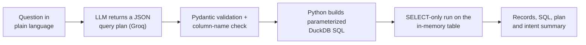
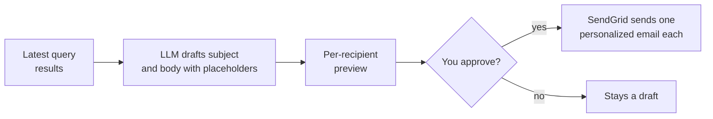

<h1 align="center">Northstar CRM</h1>

<p align="center">
  <b>An AI CRM agent: ask your customer spreadsheet questions in plain language,<br>
  then review and send personalized email campaigns.</b>
</p>

<p align="center">
  
  
  
  
  
  
</p>

<p align="center">
  
</p>

<p align="center">
  <sub>A quick tour: set up a workspace, ask which customers have a warranty ending soon, then draft and review a personalized campaign.</sub>
</p>

<p align="center">
  <a href="#features">Features</a> ·
  <a href="#quick-start">Quick start</a> ·
  <a href="#how-it-works">How it works</a> ·
  <a href="#api">API</a> ·
  <a href="#configuration">Configuration</a> ·
  <a href="#project-structure">Project structure</a> ·
  <a href="#limits-and-responsible-use">Limits</a>
</p>

---

## Overview

Northstar CRM (the **AI CRM Agent**) turns a customer spreadsheet into something you can talk to. Upload an Excel or CSV file, ask a question such as "Who has a warranty ending in the next 30 days?", inspect the matching records, and export them or use them as the audience for an email campaign.

The language model never writes SQL. It returns a structured JSON query plan, the application validates that plan against your spreadsheet's columns, and Python builds a parameterized, SELECT-only DuckDB query from it. Campaign emails are drafted by the model, previewed recipient by recipient, and only sent after you approve them.

## Features

- **Guided setup.** Enter your business name, description and contact details so email drafts sound like you, then add a spreadsheet now or later.
- **CSV and Excel upload.** `.csv`, `.xlsx` and `.xls` files are loaded into an in-memory DuckDB table.
- **Data profile.** Every field's type, distinct values, empty percentage, earliest and latest values and sample values. Email, name and date columns are detected automatically.
- **Ask in plain language.** Results appear in a sortable, paginated table with a one-line reading of what was understood. Follow-up questions build on the previous query, and recent questions can be re-run in one click.
- **See how the answer was found.** "Query details" shows the generated SQL (with a copy button) and a readable breakdown of the conditions, calculations, grouping and ordering.
- **Export.** Download the latest results as CSV, Excel or JSON.
- **Campaign drafts.** From the latest results, the model writes a subject and body with placeholders such as `{{Name}}` that are filled in per recipient. Preview every recipient's final email before anything is sent.
- **Approval before sending.** Sending takes an explicit second confirmation, goes out through SendGrid, and ends with a summary of sent, failed, duplicate and skipped emails. Rows with a missing or invalid address are flagged and skipped.
- **Audit trail.** Uploads, questions (with their plan, SQL and row count) and campaign events are written to a JSONL log and available from the API.
- **Comfortable to use.** Light, dark and system themes, keyboard-friendly dialogs with a skip link, a bottom tab bar on phones, and reduced-motion support.
- **Sample data included.** Two example spreadsheets, a quick-start PDF and a demo video ship with the app.

## Quick start

You need Python 3.10 or newer, Node.js 18 or newer and a [Groq API key](https://console.groq.com/keys). A SendGrid account is only needed if you want to send campaigns.

**1. Backend**

Windows (PowerShell):

```powershell
git clone https://github.com/Afhaam11/ai-crm-agent.git
cd ai-crm-agent\backend
python -m venv .venv
.venv\Scripts\Activate.ps1
pip install -r requirements.txt
```

macOS / Linux:

```bash
git clone https://github.com/Afhaam11/ai-crm-agent.git
cd ai-crm-agent/backend
python3 -m venv .venv && source .venv/bin/activate
pip install -r requirements.txt
```

Create `backend/.env` (you can start from `.env.example`):

```env
GROQ_API_KEY=your_groq_api_key

# Optional: only needed to send campaigns
SENDGRID_API_KEY=your_sendgrid_api_key
FROM_EMAIL=verified_sender@example.com
```

Start the API from inside `backend/`, because the modules and log paths are relative to it:

```bash
uvicorn server:app --reload    # http://localhost:8000
```

**2. Frontend** (in a second terminal)

```bash
cd ai-crm-agent/frontend
npm install
npm start                      # http://localhost:3000
```

The frontend talks to `http://localhost:8000` by default. Set `REACT_APP_API_URL` (for example in `frontend/.env`) to point it at another backend.

**3. Try it**

Open <http://localhost:3000>, enter your business details, then upload a sample spreadsheet from `frontend/public/` (or download one from the Home page):

| File | Contents |
| --- | --- |
| `customer_sales_data.xlsx` | 500 customers with product, quantity, price, purchase date, shop location, warranty dates, customer type and sales rep |
| `candidate_hr_data.xlsx` | 500 candidates with college, CGPA and results for each interview round |

Then ask something like "Who has a warranty ending in the next 30 days?", "List customers in Mysuru who bought a smartwatch" or "How many customers are there in each shop location?", and use **Draft a campaign** on the results.

## How it works

### From question to records



A query plan can express four operations (`filter`, `aggregate`, `top_n`, `search`), 27 filter operators (text matching, comparisons, ranges, null checks, lists and date shortcuts such as `last_30_days`, `next_30_days` and `this_month`), `AND`/`OR` logic between filters, grouping, aggregations (`count`, `sum`, `avg`, `min`, `max`, `count_distinct`), sorting and a row limit.

Several layers sit between the model and the data:

1. The model must return JSON that matches the `QueryPlan` schema. Unknown operators or aggregations are rejected.
2. Every column the plan mentions must exist in the uploaded spreadsheet, otherwise the error lists the available columns.
3. Identifiers are quoted and filter values are passed as positional parameters (`$1`, `$2`, ...), never pasted into the SQL text.
4. Only `SELECT` statements run, and data-changing keywords are refused.
5. Results are capped at 500 rows by default and 5,000 at most.

### From results to campaign



The draft prompt includes your business name, description and contact details, and tells the model to use only columns that exist as placeholders and never to put a recipient's address in the body. A campaign is created as `pending_approval`; the backend refuses to send anything in another state. Sending skips rows without a valid address, skips an address already sent this campaign, and reports the totals.

### What the model sees

To plan a query, the model receives your question, the previous plan (for follow-ups), and a compact schema: column names, data types and up to three example values per column. To write a campaign draft it also receives the first three recipient rows. The full spreadsheet and the complete query results stay on your backend.

### Stack

| Layer | Tools |
| --- | --- |
| Frontend | React 18 (Create React App), Axios, CSS Modules |
| Backend | FastAPI, Uvicorn, Pydantic, pandas, DuckDB (in memory) |
| AI | LangChain with a Groq-hosted LLM for query planning and email drafting |
| Email | SendGrid |
| Deployment | Vercel (frontend), Render (backend) |

## API

| Method | Path | Purpose |
| --- | --- | --- |
| GET | `/health` | Liveness, and whether the agent is initialized |
| POST | `/api/init` | Create the agent: `org_name`, `org_description`, optional `support_number` and `email_id` |
| POST | `/api/upload` | Upload a CSV or Excel file (multipart field `file`); returns the data profile |
| GET | `/api/schema` | Data profile of the loaded spreadsheet |
| POST | `/api/ask` | `{"question": "..."}` returns rows, columns, SQL, plan and intent summary |
| POST | `/api/reset` | Clear the follow-up context |
| POST | `/api/export` | `{"fmt": "csv" \| "excel" \| "json"}` returns the latest results as a file |
| POST | `/api/campaign/create` | `{"context": "..."}` drafts a campaign from the latest results |
| GET | `/api/campaign/{id}/preview` | Personalized preview, with `?recipient_index=0` |
| POST | `/api/campaign/{id}/approve` | Send the campaign through SendGrid |
| DELETE | `/api/campaign/{id}` | Delete a draft |
| DELETE | `/api/dataset` | Remove the loaded spreadsheet |
| GET | `/api/audit` | Audit entries, with `?event_type=` and `?last_n=50` |

FastAPI also serves interactive docs at <http://localhost:8000/docs>. A short session:

```bash
curl -X POST http://localhost:8000/api/init \
  -H "Content-Type: application/json" \
  -d '{"org_name": "Juniper & Co.", "org_description": "We help independent shops keep their customers coming back."}'

curl -X POST http://localhost:8000/api/upload -F "file=@customer_sales_data.xlsx"

curl -X POST http://localhost:8000/api/ask \
  -H "Content-Type: application/json" \
  -d '{"question": "Who has a warranty ending in the next 30 days?"}'
```

Example `/api/ask` response, abridged (illustrative values):

```json
{
  "intent_summary": "Find customers whose warranty expires within the next 30 days.",
  "row_count": 5,
  "columns": ["Name", "Email ID", "Product", "Warranty Expiry Date"],
  "data": [
    { "Name": "...", "Email ID": "...", "Product": "Smart TV", "Warranty Expiry Date": "2026-11-12T00:00:00" }
  ],
  "sql": "SELECT *\nFROM crm_data\nWHERE \"Warranty Expiry Date\" BETWEEN CURRENT_DATE AND CURRENT_DATE + INTERVAL '30 days'\nLIMIT 500",
  "plan": {
    "operation": "filter",
    "filters": [
      { "column": "Warranty Expiry Date", "operator": "next_30_days", "value": null, "value2": null, "logic": "AND" }
    ],
    "limit": 500,
    "intent_summary": "Find customers whose warranty expires within the next 30 days."
  }
}
```

When a question cannot be turned into a valid plan, `/api/ask` answers with HTTP 422 and an `error` message (and the plan, if one was produced). Problems reaching Groq, a rejected key or rate limiting come back as HTTP 502 with a message that says what to check.

## Configuration

| Setting | Where | Default | Purpose |
| --- | --- | --- | --- |
| `GROQ_API_KEY` | `backend/.env` | none | Required. Without it, `/api/init` fails with "GROQ_API_KEY not configured". |
| `SENDGRID_API_KEY`, `FROM_EMAIL` | `backend/.env` | none | Optional. Needed only to send campaigns, and `FROM_EMAIL` must be a sender verified in SendGrid. Without them you can still draft and preview. |
| `REACT_APP_API_URL` | `frontend/.env` | `http://localhost:8000` | Backend URL used by the frontend |
| `DEFAULT_MODEL`, `LLM_TEMPERATURE`, `LLM_MAX_TOKENS` | `backend/config.py` | temperature 0.0, 1024 tokens | Which Groq model to use and how |
| `DEFAULT_QUERY_LIMIT`, `MAX_QUERY_LIMIT` | `backend/config.py` | 500, 5000 | Row caps per query |
| CORS origins | `backend/server.py` | `localhost:3000`, `127.0.0.1:3000` and the Vercel deployment | Add your frontend's address when you host it elsewhere |

The backend writes `crm_audit_log.jsonl` and an `exports/` folder in the directory it is started from. Both are git-ignored, as is `.env`. Build the frontend for production with `npm run build`.

## Project structure

<details>
<summary><b>Show the folder layout</b></summary>

```
.
├── backend/
│   ├── server.py                 FastAPI app and routes
│   ├── crm_agent.py              ties together data, queries, campaigns and the audit log
│   ├── query_plan.py             the QueryPlan model: everything the LLM is allowed to ask for
│   ├── query_plan_generator.py   LLM call that returns a JSON plan
│   ├── query_builder.py          validates a plan and builds parameterized SQL
│   ├── query_executor.py         question, plan, SQL, result, with follow-up context
│   ├── db_manager.py             in-memory DuckDB, SELECT-only guard, exports
│   ├── schema_analyzer.py        column profiling and email, name and date detection
│   ├── email_service.py          draft generation, personalization and SendGrid sending
│   ├── audit_logger.py           JSONL audit trail
│   ├── models.py                 dataclasses for organization, schema and campaign
│   ├── config.py                 keys, model settings and limits
│   ├── requirements.txt
│   └── .env.example
├── frontend/
│   ├── public/                   sample spreadsheets, quick-start PDF, demo video
│   ├── src/
│   │   ├── components/           about, campaign, common, home, layout, query, schema
│   │   ├── context/              app state and theme
│   │   ├── services/api.js       Axios client for the backend
│   │   └── styles/               design tokens and shared UI styles
│   └── package.json
└── README.md
```

</details>

## Limits and responsible use

- **One workspace per backend.** The backend keeps a single agent, spreadsheet and set of campaigns in memory, so it serves one business at a time and forgets everything on restart. The uploaded file sits in the server's temp folder until you remove the spreadsheet.
- **No authentication.** Anyone who can reach the backend can use it. Do not expose a public backend that has live SendGrid keys, because anyone could then send email from your verified sender. For demos, leave the SendGrid keys unset: querying, drafting and previewing still work.
- **Data leaves your server for the LLM.** Column names, a few example values per column and, for campaigns, three sample rows are sent to Groq (see [What the model sees](#what-the-model-sees)). Do not use data you are not allowed to share with that provider.
- **Check the matches.** The model interprets your question, so use Query details to confirm the conditions before acting on a result, and read every draft before sending it.
- **Email responsibly.** Only email people who have agreed to hear from you, and follow the rules that apply to you, such as CAN-SPAM or GDPR.

## Author

**Afhaam Asief Ali Muhammed**, AI/ML engineer.
[LinkedIn](https://www.linkedin.com/in/muhammed-afhaam-a-23259b240) · [GitHub](https://github.com/afhaam11)
